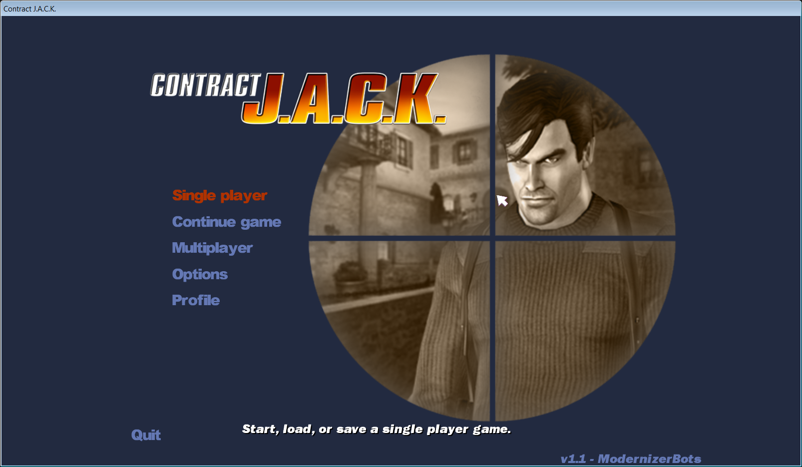
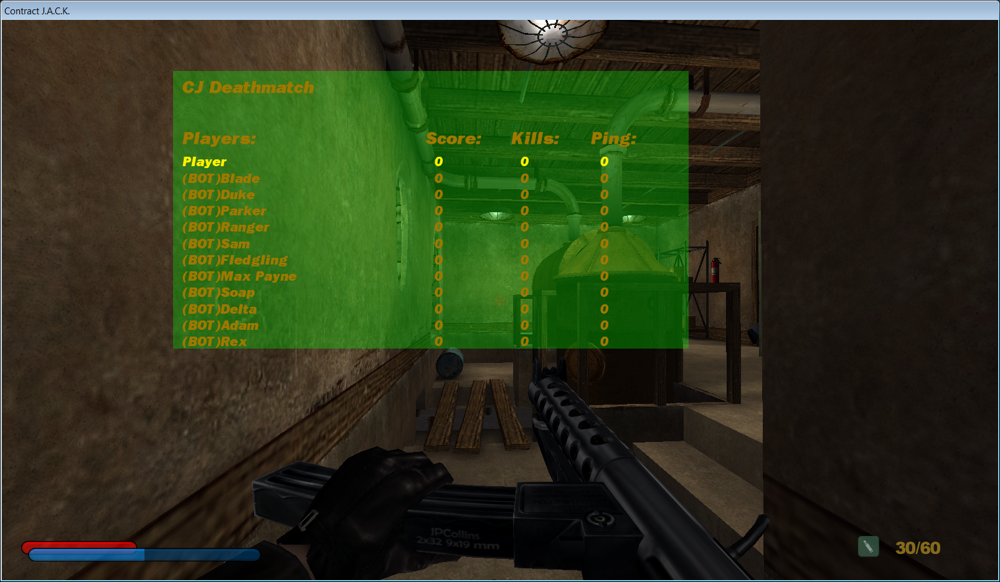

# ContractJack-modernizer
Contract J.A.C.K. Modernizer: widescreen/resolution support, restored multiplayer, and **bot support** (UT-style bots with adaptive skill, chat and taunts).

## Building
1. Put this folder inside your Contract J.A.C.K. install (next to `Tools\Source`).
2. `build.bat` builds the client; `build_server.bat` builds the server DLL (it first runs `setup_server_source.bat`, which copies the retail server source and overlays `src\ServerMods`).
3. Check `build_errors.log` if something fails.

## Bots
Host a CJ Deathmatch/Team DM game and set Bot count and Skill (Normal/Hard/Expert) on the host screen. Console commands (prefix `cmd`): `bot-add`, `bot-skill`, `bot-adapt`, `bot-chat`, `bot-help`.

## Notes
Resolutions come from the engine and SDL display modes; dgVoodoo is not required.
